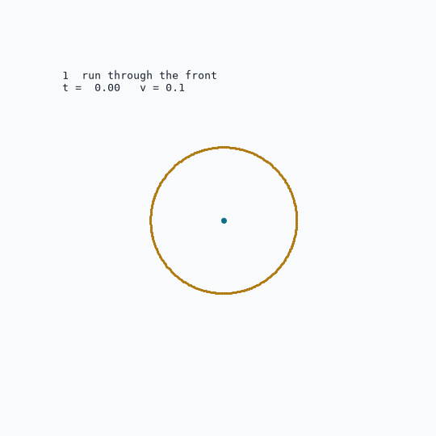

# The Invisible Snitch

A pursuit problem with an invisible target, and a proof that the pursuer wins when the target is slow enough.



## The problem

Harry starts at the origin and can move at speed at most 1. The Snitch starts at a known distance $d$ from him, in a direction $\alpha$ that he does not know. At every moment the Snitch runs directly away from Harry at speed $v < 1$:

$$
S'(t) \;=\; v\,\frac{S(t)-H(t)}{|S(t)-H(t)|},\qquad S(0)=d\,(\cos\alpha,\sin\alpha),\qquad H(0)=0,\qquad |H'|\le 1 .
$$

Harry cannot see the Snitch until he is close to it, so he must **fix his whole path in advance**. He has a vision radius $\varepsilon \ge 0$:

- for $\varepsilon > 0$, he wins if, **whatever the starting direction** $\alpha$, he comes within distance $\varepsilon$ of the Snitch at some time;
- for $\varepsilon = 0$, he must land **exactly** on the Snitch.

**Question:** for which Snitch speeds $v$ can Harry guarantee a win, and how long does it take?

Because Harry's path cannot depend on $\alpha$, he is really chasing every possible Snitch at once: one for each starting direction. Together these form a curve, the **front**, that spreads outward as Harry moves. Winning means sweeping the whole front.

The problem was posed in the video [*The Invisible Golden Snitch Riddle*](https://youtu.be/0xVusHRQePQ) (channel DON'T PANIC MATH), together with the author's notes ([Drive folder](https://drive.google.com/drive/folders/1BZDTF5uLdSdwhBKyj1G7YVmpgvtjJJr8)). The author believes Harry wins for every $v < 1$, even with $\varepsilon = 0$; that is still open.

## The result

> **Theorem.** If $v \le 6\cdot 10^{-5}$, then for every vision radius $\varepsilon \in (0, d)$ there is an explicit path, fixed in advance and of speed at most 1, along which every starting direction is seen by time $10.13\,d$.
>
> **Corollary (exact capture).** If $v \le 6\cdot 10^{-5}$, a single path of speed at most 1 lands exactly on the Snitch, whatever its starting direction, by time $10.13\,d$.

Neither the speed limit nor the time depends on $\varepsilon$, and that is what makes the corollary work. Paths that see everything by a fixed time, for vision radii shrinking to 0, converge to a path that catches everything exactly.

The speed limit is tiny because the proof is wasteful, not because the path stops working. In simulations the same path sweeps the front, in a time that does not depend on $\varepsilon$, up to about $v = 0.2$.

## How the path works

**[▶ Try the interactive simulation](https://aravindkarthigeyan.com/invisible-snitch/viz/)**: adjust the Snitch's speed and the vision radius, and compare with the obvious start the proof avoids.

1. **Run through.** Harry runs straight out along a line, through the front and a distance $d$ beyond it. Stopping at first contact would leave a corner in the front; running through leaves it smooth, apart from a small hole of directions he has already seen.
2. **Touch down.** He turns and runs straight at the candidate at angle $\arccos(v + 1/t_1)$, chosen so that this second run meets the front **tangentially**.
3. **Walk.** From the touch-down point he walks along the front in steps of length $\varepsilon$, always heading for the next unseen candidate.
4. **Close.** After going all the way round, he walks into the end of the front he left behind at touch-down. Because he left it tangentially, that end has not curled into a spiral, and the walk finishes.

## Why it works: the proof in one page

The difficulty is near Harry. As he approaches a piece of the front, the Snitches there are pushed sideways, and small kinks get amplified. Any uniform bound on the front's shape blows up as $\varepsilon \to 0$. The proof instead tracks, for every pair of points on the front, the gap between the arc length and the straight-line distance. It shows this gap stays small **at every scale from $\varepsilon$ up to a fixed size**, with constants that do not depend on $\varepsilon$.

| Step | Statement | Paper |
|---|---|---|
| Touch-down data | The two straight runs have exact formulas, so the front at touch-down is known exactly. Its tilt shrinks at small scales, both ahead of Harry and at the end he leaves behind. | §6–7 |
| End theorem | Walking the front in steps of $\varepsilon$, the arc-versus-chord gap of every pair stays bounded at every scale, right up to the last end. | §3–4 |
| Departure | The end left behind at touch-down keeps its shape while Harry walks away from it, then rejoins the main argument. | §5 |
| Assembly | For every $\varepsilon$ and $v \le 6\cdot10^{-5}$, every direction is seen by time 10.13. | §8 |
| Exact capture | A time bound independent of $\varepsilon$ passes to the limit $\varepsilon \to 0$. | §2, Cor. 1.2 |

A longer plain-language walkthrough is in **[docs/PROOF_OVERVIEW.md](docs/PROOF_OVERVIEW.md)**.

## What's in this repository

| Path | What it is |
|---|---|
| [`paper/snitch.pdf`](paper/snitch.pdf) | **The proof**: a 43-page standalone paper proving the theorem and the corollary. Start here. |
| [`paper/verify_constants.py`](paper/verify_constants.py) | Checks all 201 numerical conditions the proof relies on, in 50-digit arithmetic. |
| [`record/research-record.pdf`](record/research-record.pdf) | The full 163-page research record. It covers everything else that was found: weaker theorems for $\varepsilon>0$, lower bounds on the capture time, conditional results up to $v \approx 0.47$, refuted conjectures, and numerics. |
| [`record/reports/`](record/reports) | The research reports, referee reports and audits behind the record. |
| [`viz/index.html`](viz/index.html) | The interactive simulation. |
| [`numerics/`](numerics) | A standalone simulation of the path, the deep-scale endgame experiments, and the constant-optimisation scripts. |
| [`docs/`](docs) | The proof overview and the status of every claim. |

## Check it yourself

```bash
pip install mpmath
python paper/verify_constants.py          # ends with: ALL 201 CONDITIONS HOLD

pip install numpy matplotlib pillow
python numerics/simulate_design_T.py --v 0.1 --eps 0.03
```

To rebuild the paper, run `pdflatex snitch.tex` twice in `paper/`.

## Status: please read

- **Not yet checked by a human.** Every proof was checked by independent AI referees (two per piece) and by two end-to-end audits of the assembled argument. No human mathematician has verified it. Treat it as a detailed, carefully checked claim, not an established theorem.
- **The constants are tight by design.** Several of the 201 conditions hold with margins of a few parts per million. They are checked exactly, but they leave no room for slips.
- **Simulation is evidence, not proof.** Nothing is claimed for $v > 6\cdot10^{-5}$. With this method the ceiling looks like about $10^{-4}$; reaching the $v \approx 0.2$ that simulations suggest needs a new idea.
- **Still open:** whether Harry wins for every $v < 1$ (the author's conjecture), or whether there is a threshold.

Details, including what was refuted and what was corrected along the way, are in **[docs/STATUS.md](docs/STATUS.md)**.

## How this was made

This work came out of a multi-agent research run with Claude (Anthropic) in Claude Code. Separate AI agents proposed proofs, ran numerical experiments, refereed each other's work independently, and audited the assembled argument. A human directed the project throughout. The research record keeps the full trail, including the mistakes that were caught.

## License

Code is under the [MIT License](LICENSE). The papers and documentation are under [CC BY 4.0](LICENSE).
